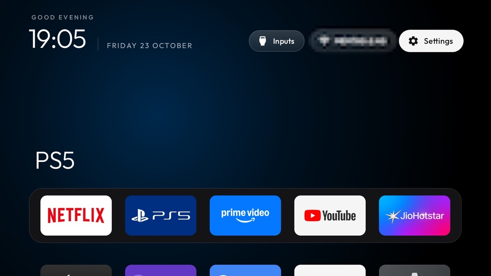

# PS5 HDMI Tile

A small Android TV app that adds a **PS5** tile to the app grid and, when CleanYourTV Home is used, can be shown as a module card. Selecting the tile opens the configured Realtek HDMI passthrough input.

This project currently targets the Sony BRAVIA VU3 (`KD-55X75K`) input configuration. The input URI is specific to that Realtek setup; other TV models, firmware, or HDMI port assignments may need a different URI.



## Build

Use JDK 17 and Android SDK 34. From this folder, run:

```sh
./gradlew --no-daemon assembleRelease
```

The release APK is written to `app/build/outputs/apk/release/app-release.apk`. Do not commit the APK.

## Module card

The card follows the [module-card contract](../../docs/modules.md). Its label is **PS5**, caption is **HDMI input**, and accent is blue.

## Permissions

- **Permissions:** None.
- **Network:** None.
- **Background services:** None.
- The app stores no user data and makes no network requests. It launches the configured TV input and exits.

## Tested on

Sony BRAVIA KD-55X75K (Google TV 14, Realtek platform).
