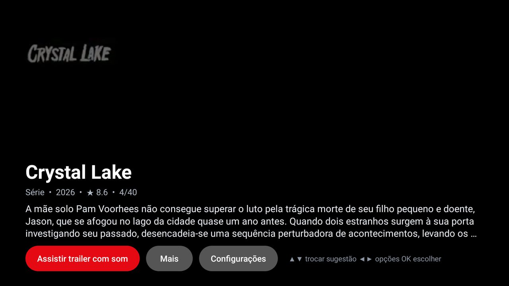

# Watch Suggestions

What to watch tonight, on the TV itself: the movies and series people are watching right now, one at a time,
with a muted trailer playing behind the title, the rating and the synopsis. **OK** plays the full trailer with
sound, **More** opens the whole synopsis. For the [Clean Your TV](../../README.md) launcher it declares a
[module card](../../docs/modules.md), so once you answer **Show card** its tile reads "Watch Picks"; on any
other Android TV home it is an ordinary app.



- **The TV's language is the source language.** Titles, synopses and trailers follow the system language and
  region (`pt-BR`, `es-MX`, `de`...). A synopsis missing in that language falls back to English.
- **Trailers in your language.** It prefers the trailers TMDB lists for your language. When there is none, or
  the video is blocked in your country, it searches YouTube for a dubbed one (Portuguese, Spanish, French,
  Italian and German have search words; other languages use TMDB's list, then the original). The muted
  preview plays any trailer; **OK** looks for one in your language first and tells you when it falls back
  to the original.
- **Always current.** The list is built again every time the app opens and every 30 minutes while it is open:
  Trakt's "most watched this week" first, then TMDB's weekly trending, ranked by a weighted rating (so a 9.0
  from 40 votes does not beat an 8.1 from 40 000) plus a small bonus for recent releases. Movies and series
  alternate.
- **Option:** *Hide anime and Asian dramas* (off by default) drops Japanese animation and series made in
  Japan, Korea, China or Thailand.
- **Remote:** Up/Down change the suggestion, Left/Right move between **Watch trailer with sound**, **More** and
  **Settings**, OK chooses, Back leaves a trailer or the synopsis.

## Your own keys

The add-on ships with no key: each person uses their own free quota.

| Key | Needed | Where |
|---|---|---|
| TMDB API key | yes | [themoviedb.org/settings/api](https://www.themoviedb.org/settings/api) (free account) |
| Trakt client id | no | [trakt.tv/oauth/applications](https://trakt.tv/oauth/applications) (free); adds the "most watched this week" signal |

Without them the app opens **Settings** on its first start and you type them with the remote's keyboard. From
a computer it is easier:

```bash
TV_HOST=<tv ip> TMDB_API_KEY=<key> TRAKT_CLIENT_ID=<id> addons/watch-suggestions/install.sh
```

Keys live in the app's private storage (backups are off) and are never logged.

## Permissions

| Permission | Why |
|---|---|
| `INTERNET` | TMDB (titles, synopses, trailer ids), Trakt (what is watched this week) and YouTube (the trailer streams and a search for a dubbed one). |

That is all: no account, no telemetry, no ads, no location, no overlay, no background service, nothing runs when
the app is closed. What is sent: your two keys to their own services, the title you are looking at to YouTube's
search, and the usual request headers. At most three trailer files (a few MB each) are kept in the app's cache
while it is open and all of them are deleted when you leave it; nothing is downloaded when the TV has less
than 300 MB free.

## How the trailers play, and what can break

YouTube's embedded player answers error 152 inside a plain Android WebView, so the app does what NewPipe and
yt-dlp do: it asks YouTube's player endpoint (as the iOS client) for the direct video and audio streams and
plays them with the system `MediaPlayer`, video muted and audio on its own track. That is an unofficial route:
YouTube can change it, and then trailers stop playing (the list, the ratings and the synopses keep working) until
the app is updated. Read YouTube's terms before using it beyond your own TV.

## Build and install

JDK 17 and Android SDK platform 34 with build-tools 34.0.0, as for the launcher:

```bash
TV_HOST=<tv ip> addons/watch-suggestions/install.sh
```

Press Home: the launcher asks once whether to show the card. The release build is signed with the debug key so
it installs over ADB like the launcher; sign your own builds with your own key if you hand them out.
