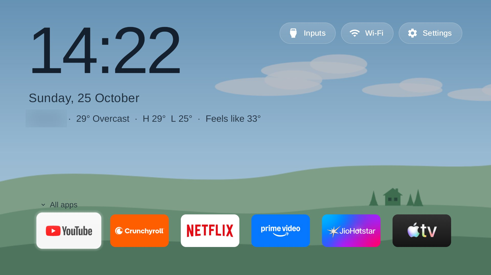
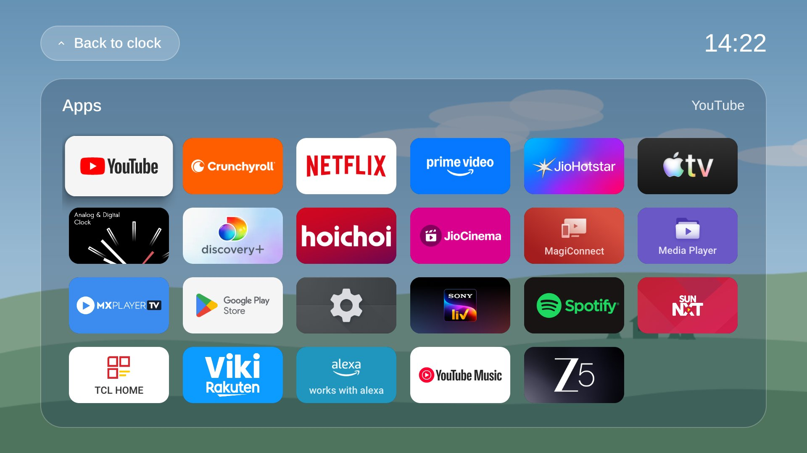
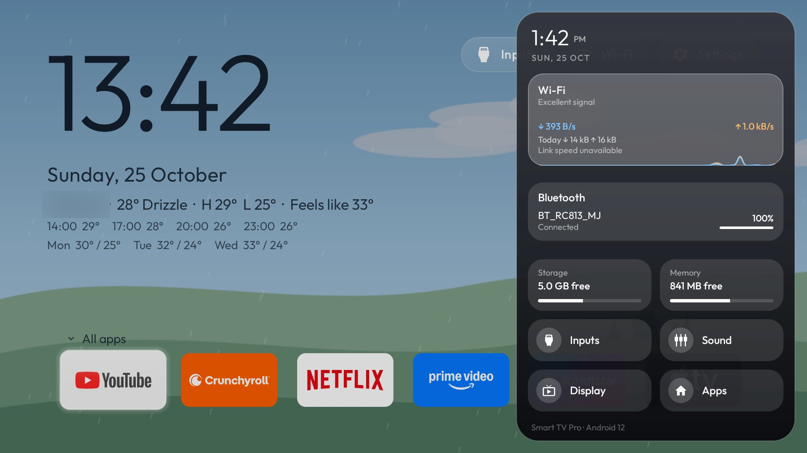

# Landscape Home (fork)

A restyle of the cleanyourtv reference launcher (`com.gathin.tvhome`), built and tested on a TCL 55C61B
(Google TV, board G09, Android 12). It lives in this fork rather than upstream because it adds network access
and a background panel, which the shared launcher keeps out on purpose.

| Home | All apps | Control Center |
|---|---|---|
|  |  |  |

The weather location is blurred in the screenshots. The Control Center shot is from before the switch to Arimo.

## What it adds

- A drawn landscape behind Home that follows the time of day (sunrise and sunset worked out for the weather
  location) and the current weather: sun, moon and stars, clouds, rain and fog. It is redrawn once a minute into
  one 960x540 bitmap, with no animation, video or blur.
- A large clock, the date on its own line, and one weather line from [Open-Meteo](https://open-meteo.com/).
  Text turns dark when the sky behind it is bright.
- Home shows only the dock apps. **Down** from the dock opens **All apps** (every app in a frosted panel);
  **Back** returns to the clock.
- The remote's Settings (gear) button opens a **Control Center** over any app: time, Wi-Fi with a live speed
  chart and today's data, Bluetooth devices with battery, storage and memory, settings tiles and the TV's
  notifications. It samples only while it is open.
- Arimo replaces Outfit everywhere (metric-compatible with Arial, which can't be bundled).

Every addition is off in `config.xml` and switched on by the theme in [`theme/config.json`](theme/config.json),
except the `config.xml` defaults for this TCL set (dock, six columns, `com.tcl.tv` as Live TV).

The release APK is about 563 KB, under upstream's 576 KB size gate. To fit, Arimo is cut down to the letters
the launcher's languages use in Latin, Cyrillic, Hebrew and Vietnamese, with kerning kept. A city name in another
script still shows, in the TV's own font.

## Network and privacy

- **Open-Meteo only.** The launcher sends the latitude and longitude from the theme, nothing else, every
  30 minutes and only while Home is on screen. No key, no account, no analytics.
- **Empty coordinates switch it off completely.** The theme ships with them empty: fill in your own
  `weather_city`, `weather_latitude` and `weather_longitude` to turn the weather line and the weather-aware sky on.
- The manifest adds `INTERNET`, `BLUETOOTH_CONNECT` (battery levels in the Control Center) and a notification
  listener (`NotificationService`, the notifications list). The listener and the Bluetooth grant are opt-in:

```bash
tools/tv.py "pm grant com.gathin.tvhome android.permission.BLUETOOTH_CONNECT"
tools/tv.py "cmd notification allow_listener com.gathin.tvhome/com.gathin.tvhome.NotificationService"
```

## Install

Build and install as the upstream README describes (`TV_HOST=<tv ip> launcher/build-and-install.sh`), then push
the theme after filling in your location:

```bash
TV_HOST=<tv ip> tools/theme.sh landscape/theme
```

The Control Center and the remote's app buttons go through the launcher's accessibility helpers. On the G09
board those helpers also stop a held volume key from repeating (one step per press), the trade described in
`docs/TROUBLESHOOTING.md`.

## Theme keys added

| Key | What it does |
|---|---|
| `scene` | `landscape` (time of day and weather), `night` (night all day) or empty (plain background) |
| `clock_style`, `clock_size` | `large` puts the date on its own line; size in sp |
| `weather_city`, `weather_latitude`, `weather_longitude`, `weather_unit` | the weather place and unit; empty coordinates mean no network at all |
| `weather_forecast` | `true` adds the next hours and days under the weather line |
| `home_dock_only` | Home shows the dock only, the rest goes to All apps |
| `dock_bottom_dp` | gap under the dock |
| `control_center` | the gear opens the Control Center instead of TV Settings |
| `input_extra` | extra rows in the Inputs menu (`Label=package/activity`) |

## Credits

- [cleanyourtv](https://github.com/Gathin23/cleanyourtv) by Gathin and contributors, MIT.
- The Control Center is ported from the "Clean TV for TCL G10" fork,
  [itsmevizz/cleanyourtv](https://github.com/itsmevizz/cleanyourtv/tree/clean-tv-launcher), MIT.
- [Arimo](https://github.com/googlefonts/arimo), SIL Open Font License 1.1 (`launcher/FONT-LICENSE-OFL-ARIMO.txt`).
- Weather data by [Open-Meteo](https://open-meteo.com/), CC BY 4.0.
